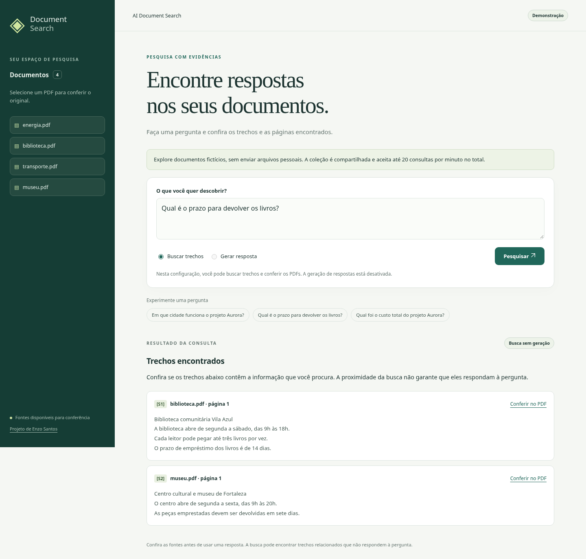

# AI Document Search

Semantic PDF search API built with FastAPI, Sentence Transformers, FAISS and Google Gemini. Upload PDFs, ask questions, and receive answers with document names and page references.

## Document workspace

Open **http://127.0.0.1:8000/ui** after starting the API. The responsive interface
is served by the same application, using HTML, CSS and JavaScript with no separate
frontend build or external assets.

- Connect with your private API key, list/upload PDFs, and follow processing status.
- Search for passages without calling Gemini, or request a generated answer when configured.
- Inspect exact excerpts and page references, open the stored original PDF, and download it.
- Distinguish an evidenced answer, missing information, and a request for clarification.

The API key stays in the current tab's memory; it is not written to browser storage
or included in PDF URLs. Refreshing the page requires reconnecting. Retrieved
passages are search results, not automatic proof that a question can be answered.



## Try the read-only demonstration

```bash
docker compose -f compose.demo.yml up --build
```

Open **http://127.0.0.1:7860/ui**. No API/Gemini key or `.env` file is needed for
this demo. It uses four fictional PDFs and the real multilingual embedding model
at a pinned weight commit. The first search downloads the model; later searches
reuse the cache. This requires initial network access and sufficient CPU/memory.

The demo collection is isolated from private documents. Upload/delete/private API
access is disabled in demo mode; search is limited to 20 requests/minute across
the instance. Generated answers are disabled by default, so the demo makes no
Gemini calls. Its normal search results should not be presented as generated answers.

For publication, see [Hugging Face Spaces instructions](deployment/README.md).
The repository includes a bundle preparer and Docker configuration;
an actual public Space URL requires publication through the owner's account.

## Requirements

- Python 3.12 (the tested runtime).
- A private `API_KEY` to use upload, list, delete and search routes.
- Internet access to download `sentence-transformers/all-MiniLM-L6-v2` on first use, or an existing local cache.
- A Gemini API key and access to the configured Gemini model to generate answers.

The API can start without either key or the embedding model. The health route and interactive documentation remain available. Missing configuration is reported only when a dependent operation is requested.

## Local installation

```bash
python3 -m venv .venv
source .venv/bin/activate
python -m pip install torch==2.14.1 --index-url https://download.pytorch.org/whl/cpu
python -m pip install -r requirements.txt
cp .env.example .env
```

The CPU PyTorch installation avoids downloading unused CUDA libraries. For GPU development, install an appropriate PyTorch build using its official instructions instead.

Edit `.env` and set `API_KEY` to your own private key. You can generate one locally:

```bash
python -c 'import secrets; print(secrets.token_urlsafe(32))'
```

Set `GEMINI_API_KEY` securely to enable answer generation, and choose a `GEMINI_MODEL` available to your account. Environment variables take precedence over `.env`; in a cloud environment, use secure environment settings rather than committing credentials. The default model name is retained from the original project and must be available to your account.

Start a single worker:

```bash
python -m uvicorn app.main:app --host 127.0.0.1 --port 8000 --reload
```

Documentation is at `/docs`, and OpenAPI at `/openapi.json`. Do not expose the service publicly before configuring a private API key. The former default key `changeme` is rejected.

## Configuration

| Variable | Purpose / default |
| --- | --- |
| `API_KEY` | Required for protected routes; no default key |
| `GEMINI_API_KEY` | Required only for generated answers |
| `GEMINI_MODEL` | Default: `gemini-3.5-flash-lite`; account availability must be verified |
| `EMBEDDING_MODEL` | Default: `sentence-transformers/all-MiniLM-L6-v2`; may be a local path to a compatible 384-dimensional model |
| `EMBEDDING_REVISION` | Optional remote model ref/commit; the resolved weight commit is recorded and verified |
| `HF_HOME` | Optional persistent Hugging Face cache directory |
| `SIMILARITY_THRESHOLD` | Maximum normalized squared L2 distance; default `1.2` |
| `TOP_K` | Maximum retrieved chunks; positive integer, default `4` |
| `CHUNK_SIZE` | Positive chunk size in characters; default `800` |
| `CHUNK_OVERLAP` | Overlap in characters, from zero to less than chunk size; default `150` |
| `MAX_UPLOAD_SIZE_MB` | Positive upload size limit; default `15` |
| `UPLOAD_DIR` | Temporary upload staging; default `uploads`, relative to the working directory |
| `DATA_DIR` | Transactional SQLite database and revisioned FAISS cache; default `data`, relative to the working directory |
| `DEMO_MODE` | Default `false`; when enabled, only the fixed public sample routes are usable |
| `DEMO_ALLOW_GENERATION` | Default `false`; opt in to generated demo answers, with a server-side Gemini key |
| `DEMO_REQUESTS_PER_MINUTE` | Shared demo request budget per instance; default `20` |
| `DEMO_GENERATIONS_PER_DAY` | Shared daily demo generation-attempt budget; default `20`; UTC windows |

Model loading happens only on the first embedding request. Use a writable persistent `HF_HOME` to reuse downloads. Required network destinations include Hugging Face and its model storage/CDN hosts, plus `generativelanguage.googleapis.com` for Gemini. A cached compatible model can be used without network access to Hugging Face.

For installation/model troubleshooting, retain TLS and download verification; do not disable certificate validation.

## API

| Method | Route | Authentication |
| --- | --- | --- |
| GET | `/` | Public health/configuration summary |
| GET | `/health` | Public health/configuration summary; browsers at `/` see the workspace |
| GET | `/ui` | Public interface; private API operations still require the key |
| POST | `/documents/upload` | `X-API-Key` |
| GET | `/documents` | `X-API-Key` |
| GET | `/documents/{filename}/pdf` | `X-API-Key`; PDF bytes from the same transactional store |
| DELETE | `/documents/{filename}` | `X-API-Key` |
| GET | `/retrieve?question=...` | `X-API-Key` (no Gemini call) |
| GET | `/search?question=...` | `X-API-Key` |
| GET | `/demo/documents` | Public, only when demo mode is enabled |
| GET | `/demo/documents/{filename}/pdf` | Public fixed sample PDFs, demo mode only |
| GET | `/demo/retrieve?question=...` | Public, rate limited, demo mode only |
| GET | `/demo/search?question=...` | Public, rate/budget limited; requires explicit generation opt-in |

Supply your configured key using the `X-API-Key` header. The health response reports whether keys are configured without returning their values; it does not contact Gemini or download a model, so it is not an end-to-end readiness test.

Upload the included demonstration PDF (with `API_KEY` exported in your terminal):

```bash
curl --fail-with-body -X POST http://127.0.0.1:8000/documents/upload \
  -H "X-API-Key: $API_KEY" \
  -F 'file=@tests/fixtures/sample.pdf;type=application/pdf'
curl --fail-with-body --get http://127.0.0.1:8000/search \
  -H "X-API-Key: $API_KEY" \
  --data-urlencode 'question=What does Project Aurora research?'
```

Answers include validated citation IDs such as `[S1]`, source filenames, page numbers, the exact retrieved text, normalized squared L2 distance and a relevance value calculated as `1 / (1 + distance)`. Both indexed and query vectors are explicitly normalized, so the distance is `2 - 2*cosine_similarity`. Only cited retrieved sources are returned with generated answers. Unknown or missing citation IDs cause a 503 instead of returning an unverifiable answer. This verifies source identifiers, not that every factual claim is supported; human review and answer-quality evaluation are still necessary. This relevance value is not a probability or a calibrated confidence score. The PDF contains fictional project information and has no personal data.

Search responses now also include `status` (`answered`, `not_found`, or
`needs_clarification`) and separate retrieval/generation timings in milliseconds.
Gemini must return schema-validated JSON. A missing fact can produce `not_found`
even when a related passage was retrieved; ambiguous questions can request
clarification. Neither response claims cited evidence. No accepted passages means
`not_found` without a Gemini call. These contracts are tested offline, but the
model's actual abstention/clarification quality still needs live evaluation.

Expected errors:

- `401`: missing or incorrect request API key.
- `503`: server API key is absent/uses `changeme`, the embedding model cannot load, Gemini is missing/unavailable, or the provider returns an empty answer.
- `400`: invalid PDF, PDF without extractable text, blank question, or no indexed documents.
- `409`: duplicate document filename.
- `503`: a storage failure or incompatible model/index identity (check logs/configuration and reindex when necessary).
- `413`: upload exceeds the size limit.

Without a Gemini key, upload/list/delete can still work if the API key and embedding model are available. Search only calls Gemini when relevant chunks are found. Scanned PDFs need OCR, which is not included.

## Tests

```bash
python -m pip install -r requirements-dev.txt
python -m pytest -q
```

The default suite requires no Gemini credentials, model download or external PDF. It uses the included two-page fixture, real PDF extraction and real FAISS persistence. Only embeddings and Gemini responses are simulated. Tests use temporary upload/index directories and block outbound socket connections. They do not modify your indexed documents. The original personal PDF filename has also been removed from the experiment script; use `python -m experiments.vector_search path/to/any.pdf --question "Your question"` for an isolated experiment.

The upload → index → search → answer → delete test checks source pages and reopens the SQLite-backed index. Storage tests inject write/delete failures, crash a subprocess before commit, and exercise simultaneous uploads and cache refresh across store instances. Other tests cover authentication, missing configuration, corrupt/blank PDFs, upload size, chunk settings, provider errors and cleanup after embedding failure. These tests verify integration wiring, not the semantic quality of the real model or answers.

### Optional live checks

Live tests are excluded by default. Run them explicitly after configuring network access, a compatible model and a valid Gemini key:

```bash
python -m pytest -q -m live tests/test_live.py
```

The embedding test downloads/loads the real model and checks a basic semantic ranking. The Gemini test makes an actual provider request and can incur usage charges; it is skipped if no key is configured. A skipped test does not establish that Gemini works.

### GitHub Actions

The **Offline tests** workflow runs the default suite for pushes and Pull Requests, with Hugging Face offline mode enabled and no API keys. It does not download the embedding model or call Gemini. Installation still downloads Python dependencies.

The workflow also runs Chromium interaction tests with intercepted API responses.
They cover connection/upload, example questions, excerpts, PDF opening, mobile
layout, clarification, rate-limit recovery, and rendering untrusted text safely.
Run them locally with:

```bash
python -m pip install -r requirements-browser.txt
python -m playwright install chromium
python -m pytest -q -m browser tests/test_browser.py
```

Browser checks are excluded from the default suite. Backend tests independently
exercise real PDF extraction, SQLite and FAISS, including demo isolation and
persistent/concurrent usage limits. A real-model browser smoke check is separate
from these simulated-response tests.

## Storage upgrade and model identity

The source of truth is now `DATA_DIR/documents.sqlite3`. Each transaction stores the PDF bytes, page-aware text and embeddings together. Deletion removes all three atomically. A failed write leaves the previous database unchanged; an in-memory FAISS snapshot is never mutated before commit. Do not manually edit the database or copy a live SQLite file without its WAL state; use SQLite's backup API or stop the service before backing up the entire data directory.

Model identifier, configured revision, vector dimension, metric and the actual resolved weight identity are stored. Remote weights are loaded from an exact Hugging Face commit; local model directories are fingerprinted by content. A model/ref/weight change is rejected rather than silently mixing incompatible embeddings. Keep local model directories immutable. Reindex into a **new** `DATA_DIR` to switch models, keeping the old collection as a backup.

### Existing three-file indexes

Startup detects the old `faiss.index` / `chunks.npy` / `embeddings.npy` layout and refuses to silently replace it with an empty index. Stop the old service and back up the whole data directory and original PDFs first. If all three files are consistent and you know the original embedding model and weight commit:

```bash
python -m app.migrate_legacy \
  --data-dir data --uploads-dir uploads \
  --legacy-model sentence-transformers/all-MiniLM-L6-v2 \
  --legacy-revision ORIGINAL_WEIGHT_COMMIT \
  --trust-legacy-pickle
```

Replace `ORIGINAL_WEIGHT_COMMIT` with the actual original revision, not a guessed current revision. Configure `EMBEDDING_MODEL` and `EMBEDDING_REVISION` to match before starting the API. The explicit trust flag is required because the old metadata format uses pickle; only use it for your own trusted files. The importer validates counts and vectors, normalizes embeddings to the new metric, builds the database privately and publishes it only after success. It never overwrites an existing SQLite database and preserves all legacy files. Existing original PDFs are copied into SQLite when available.

If the files are incomplete, inconsistent or the original model revision is unknown, restore a consistent backup or start with a **new empty data directory** and upload the original PDFs again. Do not delete the old collection to make startup pass.

## Retrieval evaluation

The [benchmark](evaluations/README.md) contains four fictional Portuguese PDFs with eight pages, including related distractors, and 20 bilingual questions. It measures source retrieval without calling Gemini:

```bash
python -m experiments.evaluate_retrieval --output evaluations/results/baseline.json
```

The [committed baseline reports](evaluations/baselines) use real models at recorded weight commits, normalized vectors, top-k 4 and threshold 1.2:

| Model | Recall@4 before threshold | Correct evidence accepted (16 questions) | MRR@4 | Unanswerable queries rejected (4 questions) |
| --- | --- | --- | --- | --- |
| all-MiniLM-L6-v2 (current default) | 93.75% | 9/16 | 0.698 | 2/4 |
| paraphrase-multilingual-MiniLM-L12-v2 | 100% | 15/16 | 0.896 | 1/4 |

The multilingual model retrieved more labeled evidence but rejected fewer unanswerable queries. These are small development-set results, not general accuracy claims or Gemini-answer scores. The default model is unchanged; validate on additional held-out PDFs before changing the model/threshold. Changing the model requires reindexing, not reusing the old vectors.

A separate [24-question holdout](evaluations/holdout/README.md) adds a reimbursement
policy, an operations runbook, a public schedule, absent facts and ambiguous
questions. Both real-model reports are committed. The multilingual model accepts
all 16 expected answer pages but also accepts passages for all four absent-fact
questions. This reinforces why retrieval acceptance is not answer confidence.
The private API default remains unchanged; the Portuguese-oriented public demo
uses the multilingual model and labels retrieval results explicitly.

The opt-in [answer evaluation](evaluations/README.md#answer-and-abstention-evaluation)
measures response status, citation identifiers, expected-page hits and latency.
It requires a configured Gemini key and explicit paid-generation opt-in. No live
Gemini answer-quality score is claimed without that run and human review.

## Docker

The Dockerfile uses Python 3.12 and CPU PyTorch, matching local setup:

```bash
cp .env.example .env
# Configure your own keys before using protected routes.
docker compose up --build
```

Compose retains the transactional database, temporary-upload directory and a model cache. PDFs, text and embeddings are now committed together in SQLite; uploaded PDFs are not kept as a second independently updated file. It binds port 8000 to loopback for local development. SQLite serializes writers, and FAISS caches are refreshed against a transaction revision. Concurrent readers use coherent snapshots. Use a local filesystem with working SQLite locks; this is not a distributed/network-filesystem storage design. Index rebuilding still loads the stored embeddings into memory, so a much larger collection needs a different scaling strategy.

If your build network uses a corporate TLS proxy, provide its trusted CA bundle using BuildKit's optional `build_ca` secret rather than disabling verification:

```bash
docker build --secret id=build_ca,src=/path/to/trusted-ca-bundle.pem -f dockerfile -t ai-document-search .
```

Proxy settings can be forwarded with the standard `--build-arg HTTP_PROXY --build-arg HTTPS_PROXY --build-arg NO_PROXY` options. The CA bundle is mounted only during installation and is not copied into the image. Runtime model/provider access still needs its own valid network and trust configuration.

## Structure

- `app/main.py`: API routes and authentication.
- `app/static/`: responsive document workspace; assets served locally.
- `app/demo.py`: fixed sample collection and transactional usage budgets.
- `app/document_processor.py`: PDF extraction and page-aware chunking.
- `app/embedding_service.py`: lazy model loading and embeddings.
- `app/vector_store.py`: transactional SQLite source of truth and rebuildable FAISS cache.
- `app/migrate_legacy.py`: explicit legacy migration; originals stay intact.
- `app/retrieval.py`: evidence labels, context and citation validation.
- `evaluations/`: PDFs, labeled questions and real-model baseline reports.
- `app/llm.py`: lazy Gemini client and answer generation.
- `tests/fixtures/sample.pdf`: reproducible, fictional two-page document.
- `tests/test_live.py`: optional checks against real external services.
- `deployment/`: Hugging Face Spaces Docker image, public README and bundle preparer.
